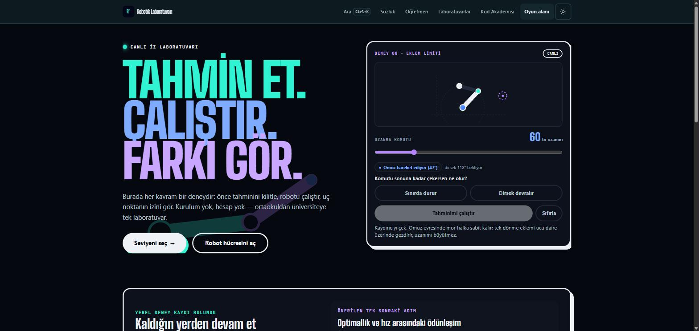
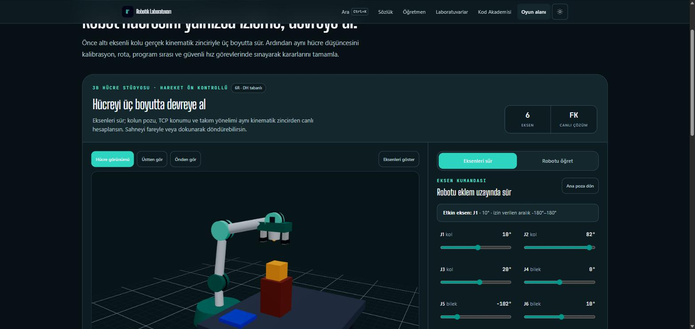
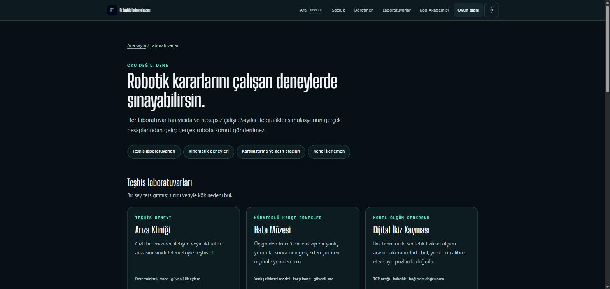
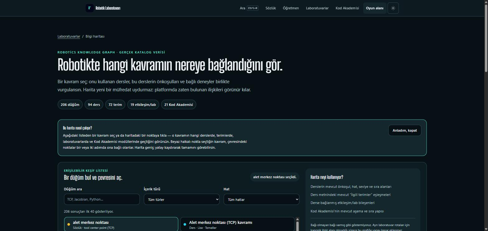
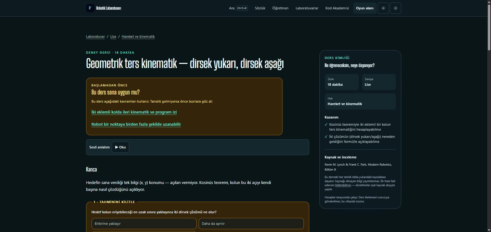

# Robotics Learning Platform

**English | [Türkçe](README.tr.md)**

[](https://robotik-platform.vercel.app/)
[](https://github.com/Merd0/robotik-platform/actions/workflows/ci.yml)
[](LICENSE)
[](LICENSE-CONTENT)
[](package.json)

An open, free **Turkish-language robotics learning platform** for middle-school, high-school, and engineering-level learners. Interactive 3D laboratories connect a structured curriculum to robotics mathematics, programming, and industrial contexts.

**[Try the live platform](https://robotik-platform.vercel.app/)** — no account, installation, or payment required.

> **Language scope:** The website and its 94 lessons currently remain **in Turkish**. The English README and [English curriculum roadmap](LEARNING_PATH.md) make the project understandable internationally; they do not imply English UI or English lessons.

## Screenshots

| | |
| --- | --- |
|  |  |
| Home page with a live exploration laboratory | Six-axis robot cell and interactive kinematics |
|  |  |
| Diagnostic, kinematics, and exploration laboratories | 206-node graph linking lessons, terms, and labs |
|  | |
| Predict first, interact, then inspect the explanation | |

## Engineering highlights

- **94 lessons, 3 levels, 8 tracks.** The prerequisite graph is checked for cycles and missing references with `npm run validate-content-graph`.
- **Validated mathematics.** Forward/inverse kinematics, Jacobians, and path-planning algorithms in TypeScript are checked against Python/PyBullet fixtures.
- **Source requirement.** Lessons must include a populated source field; CI and Git hooks enforce this structural requirement.
- **Measured accessibility/performance.** The project documents a Lighthouse accessibility score of **100/100** and tracks compressed-size budgets. These recorded measurements are not universal guarantees.
- **1,056 automated tests** reported in the project; computation runs in the browser without a required application server.
- **Traceable development.** Separate AI-assisted implementation and review histories are documented in `docs/durum-codex.md` and `docs/durum-denetim.md`. A passed check does not prove that every paragraph was manually reviewed.

## How it works

- **Interact first, read afterward:** each lesson invites exploration before explanation.
- **No installation for visitors:** use the hosted site in a browser.
- **Client-side computation:** robotics mathematics and planning live under `lib/robotics/`; advanced exercises provide Python via Pyodide.
- **Privacy-aware design:** no account, cookies, or third-party tracking are part of the described experience; progress stays in browser `localStorage`.
- **Content architecture:** lesson data lives in `content/` (MDX and glossary data) separately from application code.

## Curriculum and learning roadmap

The published Turkish curriculum spans **middle-school, high-school, and university/engineering** levels.

| Track | Topic |
| --- | --- |
| A | Fundamentals |
| B | Motion and kinematics |
| C | Path planning |
| D | Robot languages: RAPID, KRL, Mecademic, FANUC TP, ROS 2 |
| E | Communications and integration |
| F | Perception: sensors and computer vision |
| G | Simulation and digital twins |
| H | Safety and industrial practice |

**[English curriculum overview](LEARNING_PATH.md) · [Türkçe öğrenme haritası](LEARNING_PATH.tr.md)**

Only lessons marked `durum: yayinda` are visible on the site. A published status does not automatically mean every statement has been reviewed by a human.

## Local installation

Use the repository's **Node 24.x** setup and locked dependencies:

```bash
git clone https://github.com/Merd0/robotik-platform.git
cd robotik-platform
npm ci
npm run dev
```

Open `http://localhost:3000`.

The `predev` and `prebuild` steps copy Pyodide assets, bundle Web Workers using esbuild, and generate the search index into ignored `public/` assets. They are not file watchers; restart the development server if updated worker or lesson content does not appear.

### Development commands

```bash
npm run dev                     # Development server
npm run build                   # Static export to out/
npm test                        # Vitest unit tests
npm run lint
npx tsc --noEmit                # Type checking
npm run check-content           # Frontmatter and source fields
npm run validate-content-graph  # Prerequisite graph
npm run generate-fixtures       # Python reference fixtures
```

CI runs these quality checks on pushes and pull requests, with `npm audit --audit-level=high`. See [CI configuration](.github/workflows/ci.yml).

## Project structure

```text
app/               Next.js routes: lessons, levels, search, glossary
content/           Turkish MDX lessons and glossary data
lib/robotics/      UI-independent TypeScript robotics calculations
lib/               Content loading, progress, and search
components/
  scene/           Lazy-loaded Three.js scenes
  interactive/     Interactive blocks within lessons
  ui/              Navigation and common components
scripts/           Content validation, worker builds, search index
reference-python/  Python/PyBullet reference fixtures
docs/              Architecture, safety, review, and roadmap records
```

The mathematics module `lib/robotics/` intentionally avoids importing `window`, `document`, or React, keeping the core computations separate from the UI.

## Technical documentation

Internal technical documents are currently **Turkish**; this bilingual landing page does not pretend otherwise.

| Document | Scope |
| --- | --- |
| [Vision](docs/00-vizyon.md) | Goals, scope, privacy rules |
| [Curriculum](docs/01-mufredat.md) | Levels and tracks |
| [Architecture](docs/02-mimari.md) | Design invariants |
| [Roadmap](docs/03-yol-haritasi.md) | Delivery plan |
| [Content guide](docs/04-icerik-rehberi.md) | Authoring rules |
| [Experience and safety](docs/05-deneyim-ve-guvenlik.md) | UX, privacy, performance |
| [Quality](docs/06-kalite-ve-topluluk.md) | Verification strategy |
| [Design system](docs/07-tasarim-sistemi.md) | UI and accessibility |
| [Security](docs/08-guvenlik-sertlestirme.md) | Supply-chain and PR safety |
| [AI engineering](docs/09-ai-muhendisligi.md) | Development rules |
| [Review record](docs/durum-denetim.md) | Verified review scope |
| [Codex record](docs/durum-codex.md) | Parallel work logs |

## Quality model

Lesson content uses AI assistance, which increases development speed but is **not evidence of factual accuracy**. Three layers are distinguished:

1. **Numerical testing:** TypeScript implementations are checked against fixtures and unit tests.
2. **Structural/reference checks:** required source fields and valid content structure are enforced.
3. **Human review:** an optional, explicitly recorded review associated with a particular lesson version.

Source-field presence does not guarantee that every claim matches a cited source. Reports and corrections follow the project's review process.

## Contributions

Contributions to lessons, terminology, components, or corrections are welcome through PRs. See [CONTRIBUTING.md](CONTRIBUTING.md). Report vulnerabilities through [SECURITY.md](SECURITY.md), not public issues.

## Licenses

- **Executable software** (`app/`, `components/`, `lib/`, `scripts/`, `reference-python/`, configuration) — [MIT](LICENSE).
- **Lessons, prose, and documentation** (`content/`, `docs/`) — [CC BY-SA 4.0](LICENSE-CONTENT).

Third-party references cited in lessons are not relicensed by this project.

**[Türkçe README](README.tr.md) · [English curriculum](LEARNING_PATH.md) · [Türkçe öğrenme yolu](LEARNING_PATH.tr.md)**
